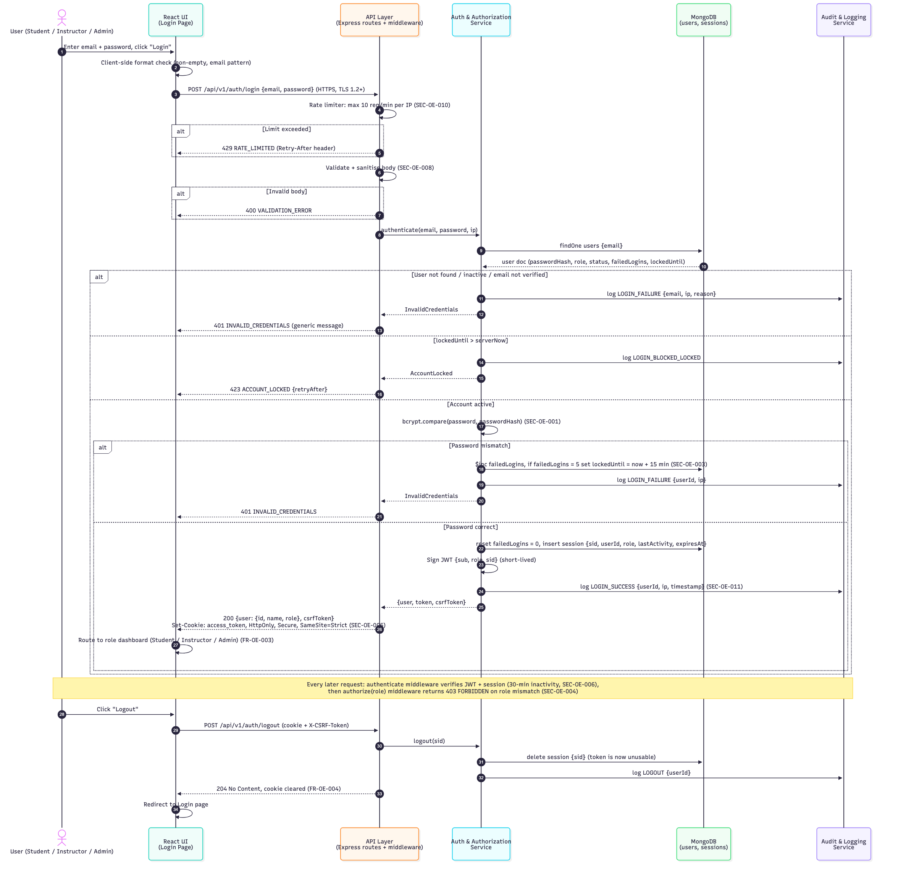
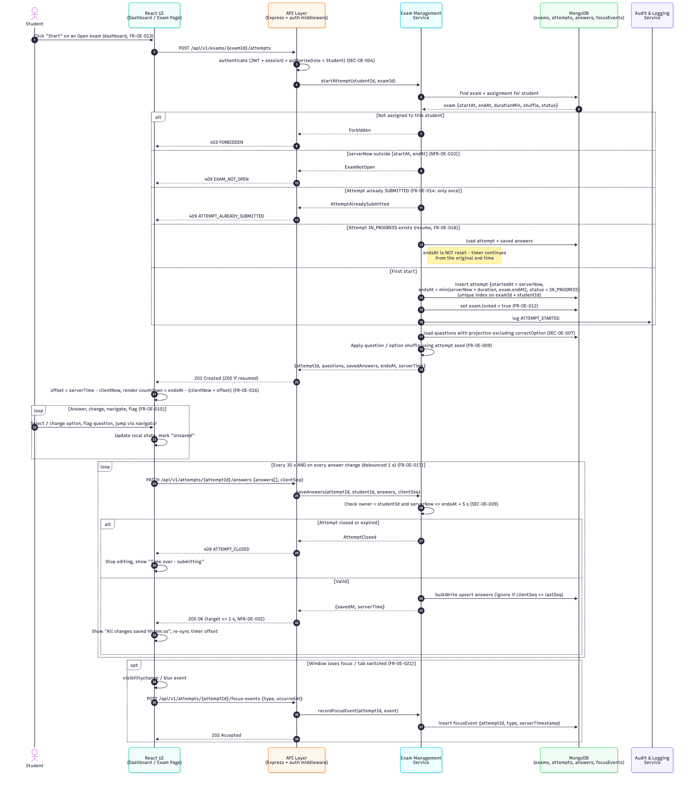
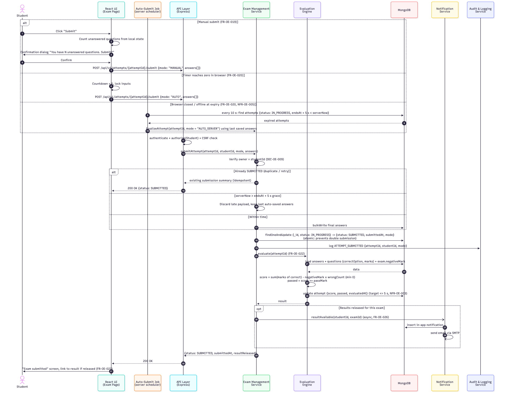

# Design (P4 – Gagan)

Full design is in **SAD_Online_Exam_Portal_v1.2.docx → Section 4**. This folder holds the diagram sources.

| ID | Flow | Use case | Source |
|----|------|----------|--------|
| SD-01 | Login / Logout | UC-02 | [SD-01_Login_Logout.mmd](diagrams/SD-01_Login_Logout.mmd) |
| SD-02 | Attempt Exam (start/resume, auto-save, focus-loss) | UC-09 | [SD-02_Attempt_Exam.mmd](diagrams/SD-02_Attempt_Exam.mmd) |
| SD-03 | Submit Exam (manual, client auto, server auto-submit, evaluation) | UC-10 | [SD-03_Submit_Exam.mmd](diagrams/SD-03_Submit_Exam.mmd) |

Detailed API specs (SAD §4.3.3): **API-03** `POST /auth/login`, **API-12** `POST /exams/:examId/attempts`, **API-13** `PATCH /attempts/:attemptId/answers`, **API-15** `POST /attempts/:attemptId/submit`. Full catalogue API-01…API-21 in §4.3.2.

Re-render a diagram: `npx -y @mermaid-js/mermaid-cli -i diagrams/SD-01_Login_Logout.mmd -o diagrams/SD-01_Login_Logout.png -s 3 -b white`

